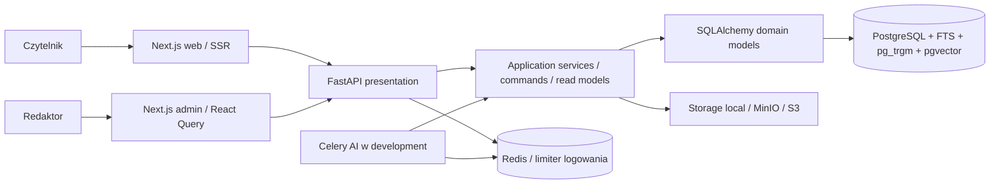
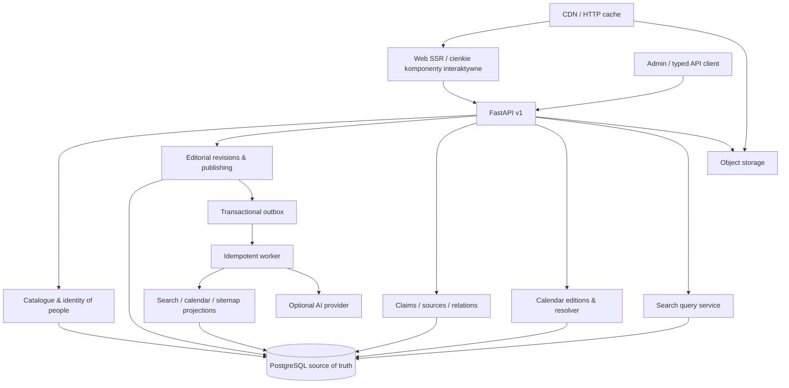

# Audyt produktu i plan rozwoju „Wszyscy Święci / Encyklopedia Świętych”

**Stan badany:** 13 września 2026. **Raport ukończony:** 14 września 2026. **Horyzont:** wrzesień 2026 – wrzesień 2028. **Podstawa:** bieżący kod, lokalna baza development, wykonane testy, inspekcja interfejsu oraz źródła benchmarku. Bazowy commit: `6745a8d77a28c8032d5e480a6637047523071d53`.

Raport odróżnia **fakt z kodu**, **obserwację lokalnego działania**, **hipotezę produktową** i **rekomendację**. Oceny są ocenami audytora, nie wynikami badań użytkowników. Nie zweryfikowano produkcji, realnego ruchu, kosztów hostingu, konwersji ani poprawności historycznej wszystkich artykułów. Nazwy proponowanych tabel i endpointów są projektem, nie inwentaryzacją istniejących funkcji.

Komplet dokumentacji: [rejestr dowodów](/Users/mateuszfidura/Desktop/all-saints/docs/product-audit-2026-09-13/evidence.md), [40 szczegółowych planów implementacji](/Users/mateuszfidura/Desktop/all-saints/docs/product-audit-2026-09-13/implementation.md), [backlog priorytetowych zadań](/Users/mateuszfidura/Desktop/all-saints/docs/product-audit-2026-09-13/backlog.md), [macierz priorytetów](/Users/mateuszfidura/Desktop/all-saints/docs/product-audit-2026-09-13/priorities.md). Numery FEATURE są wspólne dla wszystkich plików. Ścieżki w opisie implementacji są względne wobec katalogu repozytorium; klikalne odwołania do istniejącego kodu prowadzą do pełnych ścieżek lokalnych.

# 1. Executive Summary

**To zaawansowany fundament redakcyjnej encyklopedii, ale jeszcze wczesny produkt wiedzy dla odbiorcy publicznego.** Największym ograniczeniem jest rozbieżność między obietnicą wiarygodnej, połączonej wiedzy a tym, co użytkownik może samodzielnie odnaleźć i zweryfikować.

W lokalnym zbiorze znajduje się 75 opublikowanych osób. Wszystkie mają biografię i streszczenie PL, ale tylko 41 ma aktywne przypisanie źródła. Baza nie zawiera miejsc ani relacji osoba–osoba. Istnieje 12 zakonów, 19 członkostw i 69 wpisów kalendarzowych. To wartościowy pilotaż, ale nie dowód gotowości do dziesiątek tysięcy dobrze opracowanych haseł.

Backend ma realne atuty: działające rozdzielenie publicznych i redakcyjnych odczytów, szczegółowe RBAC, rotację refresh tokenów, snapshoty, ochronę przed konfliktami edycji, FTS i trigramy, import profilu, workflow oraz kontrolę jakości. Uruchomiono 282 testy backendu: wszystkie przeszły, pokrycie wyniosło 85,34%. Kontrole typów i ESLint obu frontendów oraz `alembic check` również przeszły. Nie ma podstaw do przepisywania całości ani do migracji na mikroserwisy.

Ocena ogólna: **około 6/10 jako produkt publiczny w pilotażu**, przy mocniejszym zapleczu technicznym/redakcyjnym. To osąd jakościowy, nie średnia potwierdzająca gotowość produkcyjną.

**Decyzja strategiczna:** rozwijać źródłową encyklopedię z relacyjnym modelem wiedzy w PostgreSQL. Najpierw zapewnić źródła widoczne publicznie, kontrolę publikacji i obsługę konkretnych zapytań. Następnie wzbogacać relacje i kontekst. Graf, mapa i AI powinny pojawiać się jako różne widoki tej samej, sprawdzonej wiedzy.

W pierwszych 90 dniach proponuję: naprawić bezpieczeństwo JSON-LD, usunąć nieuzasadnione etykiety „zweryfikowany”, udostępnić bibliografię, domknąć zasady publikacji i rewizji, uruchomić techniczne SEO, poprawić profil i wyszukiwarkę, zmierzyć skuteczność głównych ścieżek. Równolegle redakcja powinna opracować źródła dla pozostałych 34 profili i określić zakres kalendarza.

Największym wyróżnikiem może być możliwość odpowiedzi: **„Co wiemy, skąd to wiemy, jak pewna jest informacja, z czym się łączy i dla jakiej tradycji lub daty obowiązuje?”** Sama liczba biografii ani chatbot nie zbudują trwałej przewagi.

# 2. Current State

Monorepo składa się z trzech aplikacji: `apps/backend` (FastAPI), `apps/web` (Next.js App Router, portal publiczny), `apps/admin` (Next.js, panel). Każdy frontend ma własny `package.json` i lockfile; backend ma Poetry. Nie stwierdzono wspólnej paczki komponentów ani wygenerowanego klienta API. Orkiestracja odbywa się przez Makefile i Docker Compose. Jest to monorepo organizacyjne, bez potrzeby dodawania rozbudowanego systemu buildów przy obecnej skali.

W repo są 18 migracji, ADR-y dla slugów, kalendarza i lokalizacji, dokumentacja transakcji, RBAC i E2E, poprzedni audyt architektury oraz makiety. Dokumentacja i makiety nie są dowodem wdrożenia. W szczególności resolver kalendarza z ADR-004 jest zaakceptowanym kierunkiem, a nie działającą funkcją.

| Pomiar lokalny | Wynik | Znaczenie |
|---|---:|---|
| Opublikowane osoby | 75 | Mały katalog pilotażowy |
| Biografie / streszczenia PL | 75 / 75 | Obecność tekstu, nie weryfikacja jego treści |
| Osoby z aktywnym przypisaniem źródła | 41 / 75, 54,7% | Co najmniej 34 wymagają uzupełnienia powiązań źródłowych |
| Przypisania źródeł | 155 | Liczba relacji, nie niezależnych publikacji ani cytowanych twierdzeń |
| Miejsca / geokodowane miejsca | 0 / 0 | Mapa nie ma obecnie materiału |
| Relacje osoba–osoba | 0 | Schemat grafu wyprzedza dane |
| Zakony / członkostwa | 12 / 19 | Jeden z najlepiej rokujących istniejących szlaków eksploracji |
| Wpisy kalendarzowe | 69 | Nie oznacza pokrycia 69 różnych dni ani pełnego roku |
| Tłumaczenia | 116 | Rekord może mieć tylko część pól; nie oznacza 116 pełnych przekładów |
| Embeddingi | 0 | Semantyka lokalnie nie jest aktywnym doświadczeniem użytkownika |

Lokalnie `AI_PROVIDER=none`, wyszukiwanie AI jest wyłączone, Sentry nie ma DSN. MinIO i usługi deweloperskie działają. Nie przenoszę tego wniosku automatycznie na produkcję. Zastane zmiany użytkownika w formularzu i jego teście pozostawiono bez zmian.

# 3. Architecture Overview

To **modularny monolit z warstwami**, nie mikroserwisy. `domain` zawiera modele SQLAlchemy, więc nie jest czystym, niezależnym od ORM modelem domenowym. Serwisy aplikacyjne używają `AsyncSession` bezpośrednio. Nie ma osobnej warstwy repository dla każdej encji; jej dodanie mechanicznie podwoiłoby kod bez udowodnionej korzyści. Warto utrzymać istniejący podział command/query i test zależności zabraniający importowania `presentation` z niższych warstw.

Główne granice domenowe:

- **Hagiografia:** Person, PersonName, PersonTranslation, Canonization, Beatification, Pope, Miracle, Patronage, Relic, PersonQuote, PersonRelationship, PersonVersion, Occupation, StateOfLife, Category, Tag i tabele łącznikowe.
- **Liturgia:** LiturgicalCalendar, LiturgicalObservance, Feast. Obchód nie musi być osobą; to ważne dla uroczystości i wydarzeń zbiorowych.
- **Geografia i wspólnoty:** Country, Region, Diocese, Place, ReligiousOrder, Church oraz PersonOrder po stronie hagiografii.
- **Źródła i media:** Bibliography, HistoricalSource, PersonSource, Image, Document.
- **Tożsamość:** User, Role, Permission, tabele przypisań, RefreshToken i AuditLog.
- **AI:** PersonEmbedding oraz pola propozycji `ai_summary`, `ai_tags`; brak osobnej trwałej encji każdej propozycji.

Granice transakcji są opisane; serwisy przygotowują zmiany i flush, a adapter zarządza commit/rollback. Snapshoty i audyt zapisują istotne zmiany. Nie jest to event sourcing ani pełne wersjonowanie całego grafu. Restore soft-delete nie jest rollbackiem do dowolnej wcześniejszej wersji.

Dowody: [modele hagiografii](/Users/mateuszfidura/Desktop/all-saints/apps/backend/src/domain/hagiography/models.py), [granice warstw](/Users/mateuszfidura/Desktop/all-saints/docs/backend-layer-boundaries.md), [sesja DB](/Users/mateuszfidura/Desktop/all-saints/apps/backend/src/infrastructure/db/session.py), [polityka transakcji](/Users/mateuszfidura/Desktop/all-saints/docs/transaction-policy.md).

# 4. Existing Features

Skala: 0 brak; 1 model/stub/PoC bez kompletnej ścieżki; 2 podstawowa; 3 dobra; 4 bardzo dobra w sprawdzonym zakresie; 5 produkcyjnie potwierdzona. Żaden obszar nie otrzymuje 5 bez dowodów działania operacyjnego. Ocena dotyczy pełnej funkcji, nie samego schematu. „Działa” poniżej oznacza test lub obserwację wskazaną w rejestrze dowodów.

| Warstwa / funkcja | Stan i implementacja | Ocena | UX / jakość / ograniczenie |
|---|---|---:|---|
| Public: homepage | SSR, kalendarz dnia, patronaty, epoki, zakony, ostatnio aktualizowane | 3 | Spójna estetyka; obietnice NLP i przypisów wyprzedzają funkcje |
| Public: katalog | Formularz GET, powtarzane filtry, paginacja 18 kart | 3 | Udostępnialny URL; zbyt rozbudowany blok filtrów na telefonie |
| Public: profil | Biografia, aliasy, patronaty, modlitwa, ikonografia, uznanie, zakony | 3 | Brak bibliografii, przypisów, miejsc, TOC, powiązanych osób i wpisów kalendarza |
| Public: kalendarz | Dzień, miesiąc, obchód; kalendarze lokalny/powszechny/martyrologium | 2 | Działa dla dat stałych; lista nie jest pełnym ordo |
| Public: zakony | Katalog, profil, członkowie | 3 | Prawdziwe połączenie osoba–zakon; brakuje faset członków |
| Public: mapa / oś wydarzeń | Brak stron; epoki są odnośnikami do filtrów | 0 | Flagi feature nie dowodzą gotowości |
| Public: konta czytelników/listy/edukacja | Brak pełnych ścieżek | 0 | Role reader/guest nie tworzą funkcji konsumenckich |
| Editorial: CRUD osoby | Formularz sekcyjny, Zod/RHF, dane powiązane, avatar | 3 | Duży zakres; niespójna dostępność etykiet i rozbudowane sekcje |
| Editorial: kolejka i publikacja | draft→review→published, archiwizacja, komentarz zwrotu, RBAC | 3 | Nie wymaga źródła; zwykły update opublikowanego rekordu nie tworzy izolowanej rewizji |
| Editorial: historia i soft delete | Snapshoty, wersja, historia, restore | 3 | Historia istnieje; pełnego przeglądu diff/rollback do wybranej rewizji brak |
| Editorial: konflikty zapisu | Row lock + expected_version dla osoby; wersje tłumaczeń | 4 | Dobra ochrona w sprawdzonych ścieżkach; kontrakt expected_version osoby jest opcjonalny |
| Editorial: jakość danych | Kompletność, braki źródeł/licencji, normalizacja duplikatów | 3 | Wartościowe reguły; kompletność nie mierzy prawdziwości |
| Editorial: źródła i media | Katalogi, przypisania, upload; obsługa źródeł WWW | 3 | Udokumentowane relacje pozostają w panelu |
| Editorial: geografia i słowniki | API i ekrany krajów/miejsc/zakonów/taksonomii | 2 | Sam katalog encji nie zapewnia wypełnionych relacji |
| Editorial: role/użytkownicy | Zarządzanie szczegółowymi uprawnieniami | 4 | Dobra baza; MFA nie jest wdrożone mimo pól w User |
| Editorial: global search / dzwonek | Widoczne przyciski bez handlera | 1 | Fałszywa affordancja; usunąć lub podłączyć |
| Editorial: tłumaczenia | API create/update/delete, parent draft, wersje, fallback | 2 | Brak kompletnego dedykowanego UI i niezależnego cyklu publikacji języka |
| Data: model osób | Rozbudowany schemat i FK, enumy, relacje | 3 | Kilka bytów tylko w modelach; teksty modlitw/atrybutów nie są encjami |
| Data: Miracle / Relic / PersonQuote / PersonRelationship | Modele istnieją; brak pełnych dedykowanych publicznych ścieżek zarządzania i eksploracji w zbadanym UI | 1 | Nie mylić encji z gotową funkcją |
| Data: źródła konkretnego twierdzenia | PersonSource do rekordu | 1 | Nie ma podmiotu konkretnego stwierdzenia/fragmentu |
| Data: import profilu i zakonów | Validate/import, mapowanie relacji, eksport JSON profilu | 3 | To realny import; ogólny async import nie jest gotowy |
| Data: importy CSV/CLI | Osoby katalogowe, uznania, kalendarz, zakony | 3 | Wymaga operatora; brak wspólnej kwarantanny i manifestu całego joba |
| Data: dowolne eksporty PDF/XLSX | Zależności i stub workerów | 1 | Instalacja bibliotek nie tworzy eksportu użytkownika |
| Discovery: FTS/trigram/aliasy | Wektory TS, unaccent, ILIKE, trigram, ranking, tłumaczenia | 3 | Literówka zadziałała; brak złotego zestawu jakości i rozumienia relacji |
| Discovery: filtry | Typ, płeć, era/okres, grupy patronatów; kraj w API | 2 | Brak order/place/occupation/century/martyrdom i liczników faset |
| Discovery: semantic/related API | pgvector i provider interfaces | 2 | Kod jest; lokalnie 0 embeddingów i wyłączone AI; brak połączenia z portalem |
| Discovery: natural language | Brak parsera intencji/filtrów | 0 | Wpisanie zdania do FTS nie jest NLP |
| SEO: metadata / OG / JSON-LD | Layout + profile + wybrane podstrony | 2 | JSON-LD istnieje, ale jest niebezpiecznie serializowany; daty niedokładne |
| SEO: sitemap / robots / canonical | Brak dedykowanej kompletnej implementacji | 0 | UUID i slug mogą prowadzić do tego samego profilu; brak polityki faset |
| Platform: JWT i refresh | Access w pamięci, refresh HttpOnly, rotacja, revoke | 4 | Dobry fundament; logout nie unieważnia natychmiast już wydanego access tokenu |
| Platform: rate limiting | Atomowy Redis limiter logowania | 2 | Limity public/admin w ustawieniach nie są egzekwowane globalnie |
| Platform: cache | Redis dla embeddingów; deklaracje revalidate stron | 2 | Brak spójnej invalidacji treści; Axios nie korzysta automatycznie z cache fetch |
| Platform: testy i CI | Unit/integration, lint, types, migration check, build, E2E, prod smoke | 4 | 282 testy przeszły; tylko 3 śledzone scenariusze E2E, coverage nierówne |
| Platform: deploy/backup | Prod Compose, migrator, Nginx, backup/restore scripts | 3 | Produkcyjny Compose bez workerów Celery i monitoringu ze stosu dev |
| Platform: observability | Loguru/request ID, Prometheus, opcjonalny Sentry, health/ready | 3 | Nie wykazano alertów/SLO ani obsługi awarii przez operatora |
| API: aplikacyjne REST v1 | Publiczne GET i chronione mutacje, OpenAPI dev | 3 | To nie developer platform: brak kluczy klientów, quota, SLA, deprecation policy |

Główne dowody: [zapytania osób](/Users/mateuszfidura/Desktop/all-saints/apps/backend/src/application/services/person_query_service.py), [profil publiczny](/Users/mateuszfidura/Desktop/all-saints/apps/web/app/swieci/[slug]/page.tsx), [workflow](/Users/mateuszfidura/Desktop/all-saints/apps/backend/src/application/services/editorial_workflow_service.py), [zadania workerów](/Users/mateuszfidura/Desktop/all-saints/apps/backend/src/workers/tasks), [konfiguracja CI](/Users/mateuszfidura/Desktop/all-saints/.github/workflows/ci.yml).

# 5. Product Scorecard

Skala 1–10 dotyczy obecnego produktu i lokalnego zbioru. Nie wyliczam sztucznej „oceny produkcyjnej” ze średniej estetyki i bezpieczeństwa. Szybkość, mobile i dostępność mają mniejszą pewność ze względu na ograniczony pomiar.

| Obszar | Ocena | Uzasadnienie |
|---|---:|---|
| Użyteczność | 6 | Wyszukanie osoby i przeczytanie profilu jest możliwe; badawcze ścieżki urywają się |
| Wartość dla użytkownika | 6 | Uporządkowane teksty, patronaty i kalendarz; mały zasięg danych |
| Unikalność | 4 | Estetyka i domena są wyraziste, ale źródłowy graf nie jest jeszcze produktem |
| Kompletność danych | 3 | 75 osób, 0 miejsc/relacji, 45,3% osób bez przypisanego źródła |
| Discoverability | 5 | Linki do epok, patronatów i zakonów; brak dokładnych faset i stron tematów |
| UX | 6 | Czytelna podstawowa droga; obietnice i część kontrolek nie odpowiadają możliwościom |
| UI | 7 | Spójny język wizualny; nadmiar ramek i drobnych etykiet, długie hero profilu |
| Szybkość | 6 | Pojedyncze GET lokalnie ~11–28 ms; brak load testu, deadline Axios i budżetów payloadu |
| Dostępność | 5 | Semantyczne elementy i częściowe aria; brak pełnych etykiet/focus i audytu WCAG |
| Mobile | 6 | Układ działa przy 390 px; aliasy i filtry zajmują pierwszy ekran przed odpowiedzią |
| SEO | 4 | SSR i metadata są; brak sitemap/canonical, polityki indeksacji i bezpiecznego JSON-LD |
| Wiarygodność informacji | 4 | Istnieje redakcja, ale publikacja nie wymaga bibliografii; oznaczenie verified bez przesłanki |
| Transparentność źródeł | 2 | PersonSource istnieje, lecz czytelnik nie może go zobaczyć na profilu |
| Eksploracja wiedzy | 4 | Osoba→zakon działa; miejsca/osoby/wydarzenia jeszcze nie |
| Administracja | 7 | Workflow, role, jakość, importy i historie; brak izolowanych rewizji i recenzentów |
| Skalowalność | 6 | PostgreSQL i async wystarczą na obecny etap; kilka nieograniczonych kolekcji |
| Maintainability | 7 | Testy, ADR, migracje, podział warstw; duplikacja TS i kilka różnych ścieżek zapisu |
| Extensibility | 7 | Bogaty model i API; niektóre uogólnienia wymagają weryfikacji rzeczywistymi przypadkami |

# 6. Strengths

1. **Istnieją operacyjne piony od bazy do UI.** Osoby, zakony, źródła i kolejka nie są wyłącznie makietami.
2. **Najważniejsze mechanizmy integralności mają testy.** Dotyczy to wersji, publikacji, źródeł, tłumaczeń, slugów i RBAC. To obniża koszt ewolucji.
3. **Wyszukiwarka jest bogatsza niż prosty LIKE.** Alias z innego języka i literówka nie wymagają od razu nowego silnika.
4. **Rozróżnienie osoby i obchodu jest poprawną decyzją domenową.** Umożliwia rozwój kalendarza bez tworzenia fikcyjnych osób dla uroczystości.
5. **Źródła i obrazy mają już metadane.** Bibliografia, archiwalia, strona, cytat, licencja i pochodzenie są punktem startowym do systemu dowodów.
6. **Nie ma konieczności zmiany głównego stosu.** Dwie aplikacje Next.js i jeden backend można rozwijać stopniowo. Wyraźna separacja admin/public ma uzasadnienie.
7. **ADR-004 trafnie identyfikuje ograniczenia liturgiczne.** Należy zrealizować tę decyzję, a nie projektować drugi konkurencyjny resolver.

# 7. Weaknesses

| Problem | Dowód / skutek | Pilność |
|---|---|---|
| Niebezpieczne osadzenie JSON-LD | `JSON.stringify(jsonLd)` w `dangerouslySetInnerHTML`; zawartość pola może zamknąć element script. Potencjalny stored XSS przez złośliwą opublikowaną treść; nie wykonywano exploita na żywej bazie | P0 przed szerszą publikacją |
| Edycja opublikowanego rekordu bez osobnej rewizji | PATCH wymaga `persons:update`, ogranicza zmianę statusu, ale nie blokuje edycji treści published. Nowa treść może stać się publiczna bez kolejnej recenzji | P0/P1 zależnie od zaufania do redaktorów |
| Publiczne zapewnienie o źródłach i verified | Homepage pokazuje badge niezależnie od danych; 34/75 profili bez aktywnego przypisania źródła | P1 |
| Brak źródeł na profilu | GET person-links wymaga `sources:read`; profil ich nie pobiera | P1 |
| Kalendarz obiecuje więcej niż model | Stałe wpisy i sortowanie prezentacyjne, brak roku liturgicznego i przeniesień | P1 komunikacja, P2 resolver |
| Brak pełnej dystrybucji SEO | Brak sitemap, canonical, zasad faset, stron problemów i miejsc | P1 |
| Nieaktywne elementy panelu | Topbar search i notification bez akcji | P2, tani fix |
| AI confidence jest stałą heurystyczną | Sugestie używają m.in. stałych 78/65; nie jest to skalibrowane prawdopodobieństwo | P1 przed eksponowaniem „pewności” |
| Niespójność konfiguracji i wdrożenia | Feature flags maps/timeline/exports mogą być true bez funkcji; prod Compose nie ma Celery | P1 przed włączeniem zależnych funkcji |

[Serializacja JSON-LD](/Users/mateuszfidura/Desktop/all-saints/apps/web/app/swieci/[slug]/page.tsx:141), [mutacje osób](/Users/mateuszfidura/Desktop/all-saints/apps/backend/src/presentation/api/v1/persons/mutations.py:52), [serwis aktualizacji](/Users/mateuszfidura/Desktop/all-saints/apps/backend/src/application/services/person_service.py:202), [topbar](/Users/mateuszfidura/Desktop/all-saints/apps/admin/components/layout/topbar.tsx:28), [heurystyki AI](/Users/mateuszfidura/Desktop/all-saints/apps/backend/src/application/ai_suggestions.py).

# 8. Missing Capabilities

**Critical gaps:** bezpieczny renderer; zasady, która wersja jest opublikowana; bibliografia dla całego opublikowanego pilotażu; źródła publiczne; uczciwy status kalendarza i danych; ograniczenie nieograniczonych zapytań i kosztownych operacji; podstawy SEO. To warunki szerszego uruchomienia, niezależne od liczbowego score.

**High-value gaps:** fasety relacyjne, profil jako punkt eksploracji, konkretne patronaty, źródła twierdzeń, daty niepewne, miejsca, pomiar sukcesu wyszukiwania, deduplikacja ze scalaniem i workflow rewizji. Dostarczają przewagi bez zmiany infrastruktury bazowej.

**Long-term opportunities:** wersjonowany kalendarz normatywny, mapa i oś czasu, badawcze porównanie źródeł, ścieżki edukacyjne, hybrydowe wyszukiwanie, ograniczone Q&A oraz platforma API. Ich uruchomienie zależy od jakości korpusu i potwierdzonej potrzeby, nie od ukończenia samego ekranu.

Poza funkcjami brakuje ustalonej polityki redakcyjnej: zakresu wyznań i tradycji, kryteriów doboru postaci, standardu przypisu, zasad korekty błędu, oznaczania legendy i autorskich modlitw, oraz odpowiedzialności za kalendarz. Nie da się zastąpić tych decyzji kolejną kolumną `confidence`.

# 9. User Personas

Persony są hipotezami do sprawdzenia, nie wynikiem przeprowadzonych wywiadów. Najpierw należy obsłużyć trzy grupy: czytelnik szukający konkretnej odpowiedzi, redaktor oraz nauczyciel/badacz wymagający źródła.

| Persona | Cel i typowe zadanie | Oczekiwanie / obecny problem | Największa wartość |
|---|---|---|---|
| Osoba sprawdzająca dzień | Kogo dziś wspominamy i dlaczego? | Jednoznaczna data i kalendarz; wpis stały nie rozstrzyga obchodów roku | Kontekst kalendarza, zakres pokrycia, profil |
| Osoba szukająca patrona imienia / bierzmowania | Porównać kilka osób o tym imieniu | Aliasy pomagają, ale brak rozróżniania homonimów i porównania | Fasety, krótkie portrety, kolekcje |
| Osoba szukająca patrona problemu/zawodu | Znaleźć patronów chorych, lekarzy, podróżnych | Cztery ogólne grupy to mało; niejasne pochodzenie patronatu | Strony patronatów i źródła przypisania |
| Zainteresowany historią | Zrozumieć epokę i relacje | Długi tekst bez przejść do zdarzeń i miejsc | Oś czasu, powiązania, słownik kontekstu |
| Student / seminarzysta | Przygotować pracę, znaleźć źródło | Brak publicznej bibliografii i trwałego przypisu | Cytowanie twierdzeń, eksport bibliografii |
| Historyk / teolog | Porównać tradycje i daty | Pojedyncza wartość i proza ukrywają rozbieżność | Twierdzenia alternatywne, daty przedziałowe, wersje |
| Nauczyciel / katecheta | Zbudować lekcję dla wieku uczniów | Brak materiału o określonym czasie i poziomie | Ścieżki, quizy, wydruk źródłowy |
| Duchowny / osoba przygotowująca liturgię | Zweryfikować obchód dla miejsca i roku | Nie może polegać na obecnym resolverze dat stałych | Edycje kalendarza, wyjątki, wyjaśnienie wyniku |
| Pielgrzym / przewodnik | Znaleźć relikwie, sanktuarium, trasę | Brak miejsc; historyczna relacja nie oznacza dostępności obiektu | Źródłowa mapa; informacja kiedy sprawdzono dane odwiedzin |
| Genealog / badacz lokalny | Warianty nazw i historyczna geografia | Współczesny kraj nie odpowiada narodowości dawnej osoby | Aliasy, identyfikatory, granice czasowe |
| Redaktor | Dodać, poprawić i udokumentować profil | Duży formularz, brak osobnej rewizji i assignment | Draft rewizji, walidacja, import staging |
| Recenzent | Sprawdzić zmiany, źródła i spory | Historia bez dobrego porównania; brak właściciela zadania | Diff, komentarze do pól, bramki jakości |
| Tłumacz | Przekładać opublikowany materiał | Edycja tylko gdy osoba draft; UI PL | Rewizja językowa powiązana z wersją źródłową |
| Administrator / SRE | Bezpiecznie obsłużyć publikację i awarię | Brak dowodu alertów i workerów w prod | Runbook, restore, metryki, limity |
| Twórca treści | Zacytować fakt i legalnie użyć ilustracji | Bibliografia i licencja niewidoczne w potrzebnym miejscu | „Cytuj”, podpis obrazu, permalink wersji |
| Developer / partner | Pobrać stabilne dane z pochodzeniem | Aplikacyjne API bez polityki quota i zmian kontraktu | Dataset release, eksporty, API keys |

Discovery: 12–16 wywiadów obejmujących czytelników, redakcję i odbiorców źródłowych; po 5–8 prób najważniejszych ścieżek; 30–50 realnych pytań do pierwszego benchmarku. Po 4 tygodniach zweryfikować, czy priorytety użytkowników faktycznie są inne niż liczba biografii.

# 10. User Journeys

| Ścieżka | Dziś | Usprawnienie i test sukcesu |
|---|---|---|
| Kto jest patronem dzisiejszego dnia? | Homepage→dzień; działa lista dat stałych | Rozdzielić „wspomnienie” i patronat, wyświetlić zakres kalendarza; użytkownik potrafi podać źródło i zakres odpowiedzi |
| Patron mojego imienia | Wpisanie imienia/aliasu→wyniki→profil | Disambiguacja datą/zakonem/miejscem; poprawny wybór w ≤3 działaniach |
| Wszyscy święci z Polski | Kraj istnieje w API, brak kontroli w publicznym katalogu | Osobno narodowość/urodzenie/działalność/śmierć; nie nazywać obecnego birth-or-death filtra „Polscy” |
| Męczennicy XX wieku | Brak typowanej cechy męczeństwa i precyzyjnego filtra; próbne zdanie dało 0 | Evidence-backed martyrdom event i przedział dat; test na uzgodnionym zbiorze |
| Święci dominikanie | Homepage/zakony→dominikanie→osoby | Filtr członkostwa oraz typ osoby; nie mieszać członka z osobą inspirowaną duchowością |
| Dominikanie XIII wieku z Italii | Nie ma przecięcia tych kryteriów | Relacyjne filtry order + activity range + typed place; pokaż interpretację i braki danych |
| Osoby związane z miejscem | Brak publicznej ścieżki i danych Place | Profil miejsca z typami relacji i datami; każde połączenie ma źródło |
| Patron problemu lub zawodu | Ogólne grupy i przeszukiwanie tekstów patronatów | Słownik pojęć, synonimy, relacja person→patronage concept; wynik wyjaśnia przyczynę |
| Dlaczego uznano osobę za świętą? | Tekst biografii i opcjonalna data beatyfikacji/kanonizacji | Sekcja „Kult i uznanie”, typ uznania, dokument, tradycja; nie wymuszać nowożytnej kanonizacji dla dawnych postaci |
| Osoba→zakon/miejsce/patronat/wydarzenie | Zakon jest linkiem; reszta tekstem lub nieobecna | Wspólny wzorzec karty relacji; 2-hop exploration z powrotem do profilu |
| Redaktor dodaje nowego świętego | Sekcyjny formularz, źródła, avatar, workflow | Najpierw minimalny draft, potem jakość/review; zachowanie wpisu przy konflikcie i błędzie walidacji |
| Redaktor aktualizuje opublikowaną biografię | Edytuje ten sam rekord | Draft nowej rewizji; publiczna wersja nie zmienia się do zatwierdzenia |
| Weryfikacja źródła informacji | Czytelnik nie ma bibliografii profilu | Kliknięcie przypisu→strona/cytat/źródło; metadane pozwalają odnaleźć dokument także offline |

# 11. Competitive Benchmark

To benchmark **wzorców**, nie audyt całych konkurencyjnych produktów ani porównanie ruchu. Źródła sprawdzono 13.09.2026; tam, gdzie dostęp do stron był ograniczony, wykorzystano indeksowane oficjalne materiały. Wnioski o adaptacji są rekomendacjami audytora.

| Serwis | Wzorzec i źródło | Adaptacja | Czego nie kopiować |
|---|---|---|---|
| Wikipedia | Weryfikowalność twierdzeń i przypisy — [polityka](https://en.wikipedia.org/wiki/Wikipedia:Verifiability) | Sekcje, historia, jawna niepewność i odsyłacze do dokumentów | Otwartej edycji bez zasobów moderacyjnych |
| Wikidata | Referencje przypisane do statements — [Help:Sources](https://www.wikidata.org/wiki/Help:Sources) | Typowana informacja, kwalifikatory, provenance, identyfikatory zewnętrzne | Modelu wszystkiego jako luźnych trójek bez integralności domenowej |
| Britannica | Kontrolowany proces redakcyjny — [o encyklopedii](https://www.britannica.com/topic/Encyclopaedia-Britannica-English-language-reference-work) | Widoczny autor/recenzja i syntetyczne wprowadzenie | Bariery dostępu do podstawowej odpowiedzi w młodym produkcie |
| CatholicSaints.info | Indeksy hagiograficzne i wejścia tematyczne — [katalog](https://catholicsaints.info/) | Strony patronatów, imion i wspomnień jako wejścia do treści | Duplikacji hasła zamiast jednej tożsamości osoby |
| Vatican.va | Oficjalne dokumenty i archiwum AAS — [archiwum](https://www.vatican.va/archive/aas/index_it.htm) | Trwałe lokalizatory dokumentów, rok/tom/strona, cytat | Założenia, że pojedynczy dokument jest źródłem wszystkich danych biograficznych |
| GCatholic | Przekrojowe katalogi struktur kościelnych — [serwis](https://gcatholic.org/) | Nawigacja terytorium→instytucja→osoba, powiązania nazw | Rozbudowania każdej hierarchii przed wypełnieniem danych |
| Catholic-Hierarchy | Historia osób i diecezji — [katalog](https://www.catholic-hierarchy.org/) | Urzędy i relacje z przedziałem obowiązywania | Traktowania obecnego stanowiska jako ponadczasowej cechy |
| IMDb | Osoba i dzieło spięte konkretną rolą — [dokumentacja wkładów](https://help.imdb.com/) | Członkostwo/uczeń/założyciel jako relacja z metadanymi | Popularności jako miary wiarygodności historycznej |
| Discogs | Rozróżnienie tożsamości wersji i scalania — [Merge Release](https://support.discogs.com/hc/en-us/articles/360005006954-Database-Guidelines-17-Merge-Release) | Nie mylić grupowania tradycji/wydań z usunięciem duplikatu osoby | Bezrefleksyjnego łączenia osób o podobnych nazwach |
| Goodreads | Odkrywanie i listy do przeczytania — [o serwisie](https://www.goodreads.com/about/us) | Kolekcje tematyczne i „przeczytam później” | Ocen gwiazdkowych świętych |
| Letterboxd | Listy, dziennik i obserwowanie — [FAQ](https://letterboxd.com/about/faq/) | Ścieżki czytania, zapisane kolekcje, powrót do tematu | Pełnej sieci społecznościowej przed udowodnieniem retencji |
| Google Knowledge Graph | Identyfikacja encji i powiązanie opisów — [dokumentacja](https://developers.google.com/knowledge-graph) | Stabilne ID, disambiguacja i `sameAs` | Utożsamiania własnego JSON-LD z gwarancją panelu Google |

Najlepsze połączenie dla tego projektu: rygor przypisów Wikipedii/Wikidata, redakcyjna odpowiedzialność encyklopedii, domenowa precyzja katalogów kościelnych i lekkość eksploracji list Letterboxd. Przewaga wymaga źródeł i pracy redakcyjnej; UI grafu można łatwo skopiować.

# 12. Feature Opportunities

Zdefiniowano **40 możliwości rozwoju**, obejmujących nowe funkcje i domknięcie obecnych. Każda ma problem, personę, wartość, złożoność, zależności, ryzyka oraz plan produktu/backendu/DB/frontendu/testów/infrastruktury w [implementation.md](/Users/mateuszfidura/Desktop/all-saints/docs/product-audit-2026-09-13/implementation.md). Wszystkie dziewięć ocen 1–10 i wyliczony Priority Score znajdują się w [priorities.md](/Users/mateuszfidura/Desktop/all-saints/docs/product-audit-2026-09-13/priorities.md).

| Grupa | Funkcje |
|---|---|
| Wiarygodność i publikacja | 001 Uczciwe statusy i obietnice; 002 Publiczna bibliografia; 003 Źródłowa bramka publikacji; 004 Izolowane rewizje; 005 Bezpieczny JSON-LD |
| Discovery i profil | 007 Fasety relacyjne; 008 Ranking i benchmark; 009 Profil jako punkt odkrywania; 010 Wspomnienia i pokrycie kalendarza; 018 Powiązane osoby i kontekst |
| Knowledge Graph i dane | 014 Patronaty/atrybuty/zawody jako pojęcia; 015 Daty i zdarzenia; 016 Twierdzenia i przypisy; 017 Miejsca i role geograficzne |
| Maps / Timeline | 019 Historyczna oś czasu; 020 Mapa źródłowa |
| Calendar | 021 Wersjonowany resolver; 034 ICS i obserwowane wspomnienia |
| Editorial / Data Quality | 022 Recenzje, diff i rollback; 023 Staging importu; 024 Entity resolution; 025 Kolejki jakości |
| AI | 026 Trwałe propozycje i provenance; 027 Hybrid search; 028 Natural language→filtry; 029 Q&A ze źródłami |
| Education / Personalization | 030 Lokalizacja treści i UI; 031 Kolekcje redakcyjne; 032 Ścieżki i quizy; 033 Ulubione i prywatne listy |
| SEO / UX | 006 Cykl indeksacji; 012 Dostępność i mobile; 040 Media, podpisy i licencje |
| Platform / API | 011 Wydajność i cache; 013 Analityka; 035 API i eksporty; 036 Outbox/webhooks; 037 SRE; 038 Ochrona dostępu i zasobów; 039 Typowane kontrakty |

Nie należy traktować 40 pozycji jako zobowiązania do implementacji wszystkich. W fazach 0–2 rekomendacja jest bezpośrednia; funkcje badawcze/AI/API w dalszych fazach wymagają przejścia bramek popytu i danych.

# 13. Quick Wins

Szacunki dotyczą pracy jednej osoby znającej repo, bez czasu masowego opracowania treści; obejmują implementację i podstawową weryfikację. To małe przyrosty większych FEATURE, a nie koszt całego epika.

| Quick win | Frontend | Backend | DB | Trudność / zależność |
|---|---|---|---|---|
| QW1 — usunąć bezwarunkowe verified (001) | Zastąpić badge informacją o aktualizacji; poprawić copy homepage/footer | Bez zmian w wersji minimalnej | Brak | XS, 0,5 dnia; uzgodnić terminologię |
| QW2 — komunikat możliwości wyszukiwarki (001/008) | Usunąć sugestię pytań naturalnym językiem, podać przykłady aliasu/patronatu | Brak | Brak | XS, 0,5 dnia |
| QW3 — bezpieczny JSON-LD (005) | Serializator neutralizujący `<` przed osadzeniem; test zamknięcia script | Brak | Brak | S, 0,5–1 dnia |
| QW4 — publiczna bibliografia v1 (002) | Sekcja źródeł profilu | Osobny publiczny DTO, tylko published i aktywne źródła; bez notatek redakcyjnych | Wykorzystać PersonSource | S/M, 2–3 dni; kontrola widoczności |
| QW5 — wymagane źródło przy publikacji (003) | Czytelny blocker w kolejce | Jedna wspólna polityka w workflow i jakości | Bez migracji, raport istniejących braków | S/M, 1–2 dni; decyzja wyjątków |
| QW6 — spis sekcji profilu (009) | Anchory, skok do źródeł, zwijane aliasy | Brak | Brak | S, 1 dzień; QW4 |
| QW7 — widoczny focus i label (012) | Label wyszukiwarki, peer-focus-visible, skip link, jeden main | Brak | Brak | S, 1–2 dni; test klawiaturą |
| QW8 — kraj urodzenia lub śmierci (007) | Kontrolka i URL; dokładnie tak nazwana | Wykorzystać istniejący country_id | Brak | S, 1–2 dni; nie nazywać filtrem narodowości |
| QW9 — walidacja `page` i reset filtrów (007/012) | Liczba całkowita ≥1, stan pusty, zachowanie filtrów po powrocie | Zachować Pydantic ge=1 | Brak | S, 1 dzień |
| QW10 — canonical i podstawowy sitemap (006) | MetadataBase, canonical slug; sitemap tylko published | Paginowany odczyt ID/slug/updated_at dla sitemap, jeśli obecny odczyt jest zbyt ciężki | Bez nowej tabeli w v1 | M, 2–3 dni; domena z konfiguracji |
| QW11 — jasna granica kalendarza (010) | „Wpisy stałe; katalog w trakcie opracowania”; pusty dzień ≠ brak świętych | Metadane zakresu/pokrycia | Brak w minimum | S, 1 dzień; opis ADR-004 |
| QW12 — martwe przyciski panelu (001) | Podłączyć wyszukiwanie do listy osób; usunąć dzwonek bez funkcji | Użyć istniejącej listy admin | Brak | S, 1 dzień |
| QW13 — timeout i wspólny odczyt profilu (011) | Deadline Axios i request-scoped deduplikacja metadata/page | Brak | Brak | S, 1–2 dni; test API timeout |
| QW14 — korekta etykiet jakości (025) | „Kompletność” i lista spełnionych kryteriów; bez procentu prawdy | Usunąć arbitralne confidence z publicznej interpretacji | Brak | S, 1 dzień |

Nie zaliczam do quick wins: kompletnego kalendarza liturgicznego, nowej bazy grafowej, masowego AI ani wydzielania serwisów. Publiczna bibliografia jest mała technicznie, ale jej **uzupełnienie** wymaga osobnego czasu redakcyjnego.

# 14. Big Bets

| Zakład strategiczny | Wartość i potencjalna przewaga | Wpływ architektoniczny / dane | Implementacja i ryzyko |
|---|---|---|---|
| Źródłowa encyklopedia twierdzeń (016) | Czytelnik rozumie rozbieżności i może sam sprawdzić fakt | Assertion, Evidence, cytaty, wersje; FK i kontrolowane predykaty | Pilotaż dat/kultu/patronatu; największy koszt to redakcja, nie DB |
| Relationship Explorer (014–018) | Precyzyjne pytania typu dominikanie XIII wieku związani z Italią | Typowane relacje i zakres czasu | Najpierw formularz i lista wyjaśnień, graf jako dodatkowy widok; ryzyko niekompletności relacji |
| History + Geography Explorer (019/020) | Jednoczesna eksploracja czasu, miejsca i osoby | Zdarzenia, przedziały i koordynaty z pochodzeniem | Jedna kompletna kolekcja pilotażowa, nie pusta mapa świata; unikać fikcyjnej dokładności |
| Liturgical Explorer (021) | Wiarygodna odpowiedź dla konkretnego roku i kalendarza | Edycje/reguły/wyjątki/projekcje według ADR-004 | PL + uniwersalny, kilkuletni golden corpus; wymagany recenzent liturgista |
| Redakcyjna platforma współpracy (004/022/023/025) | Bezpieczne skalowanie wkładu wielu redaktorów | Rewizje, assignment, joby, wspólna polityka jakości | Wyizolować publikowaną wersję przed delegowaniem pracy; ryzyko zbyt skomplikowanej kolejki |
| Wyszukiwanie znaczenia z wyjaśnieniem (027/028) | Pytania naturalne i znalezienie nieoczywistej osoby | Read model wyszukiwarki i wersjonowane embeddingi | Filtry egzekwuje SQL, AI tylko interpretuje; ryzyko błędnego zawężenia |
| Edukacyjne ścieżki i kolekcje (031/032) | Powtarzalne użycie przez szkoły/parafie | Lekki model lekcji i kuratorowane profile | 3–5 ścieżek z odbiorcami pilotażowymi; ryzyko kosztu utrzymania treści |
| Referencyjne dane dla partnerów (035/036) | Stabilne identyfikatory, eksport źródłowy, widżety | Wersje datasetu, quota, outbox | Pilotaż z 2–3 konkretnymi partnerami; ryzyko obsługi klienta i licencji |

Warunek kontynuacji każdego zakładu: mierzalne użycie, dostępny właściciel danych oraz poprawa choć jednej głównej ścieżki. Nie budować wszystkich równolegle.

# 15. Search Strategy

**Pozostawić PostgreSQL FTS + pg_trgm.** Dodać semantykę dopiero po ocenie jakości i wypełnieniu danych. Liczba kilkudziesięciu tysięcy haseł sama nie uzasadnia osobnego klastra wyszukiwania.

Obecna implementacja łączy `websearch_to_tsquery('simple', unaccent(term))`, ranking TS, ILIKE, trigram `%`, aliasy i tłumaczenia. Jest od razu lepsza niż implementowanie tych mechanizmów od nowa. Konfiguracja `simple` nie rozwiązuje fleksji języka polskiego. Filtr kraju oznacza miejsce urodzenia **lub** śmierci, nie narodowość. Wielokrotne wartości wewnątrz kategorii tworzą OR; różne kategorie — AND. Okres ma pierwszeństwo przed erą. To trzeba opisać i zachować w testach.

| Rozwiązanie | Zalety | Ograniczenie / koszt | Decyzja |
|---|---|---|---|
| PostgreSQL FTS | Spójność z transakcją, GIN, brak synchronizacji drugiej bazy | Strojenie języka i rankingu; fasety trzeba zaprojektować | Rdzeń teraz — [dokumentacja](https://www.postgresql.org/docs/current/textsearch.html) |
| pg_trgm | Literówki, podobieństwo nazw, indeksy dla ILIKE | Słabsza selektywność krótkich zapytań; to nie semantyka | Zachować jako uzupełnienie — [dokumentacja](https://www.postgresql.org/docs/current/pgtrgm.html) |
| Elasticsearch | Zaawansowane analizatory, agregacje, hybrid retrieval | Osobny indeks, operacje, wersje i koszt utrzymania | Tylko jeśli pomiary/analiza językowa uzasadnią — [hybrid search](https://www.elastic.co/docs/solutions/search/hybrid-search) |
| OpenSearch | Rozbudowane wyszukiwanie i hybrydowe pipeline | Podobny koszt operacyjny klastra i synchronizacji | Alternatywa dla potwierdzonej potrzeby — [dokumentacja](https://docs.opensearch.org/latest/vector-search/ai-search/hybrid-search/index/) |
| Meilisearch | Dobre wzorce typeahead/faset i prostszy start osobnego silnika | Oddzielna projekcja i jej aktualizacja; należy zbadać ograniczenia faset | Kandydat do krótkiego PoC, nie zależność fazy 1 — [facet search](https://www.meilisearch.com/docs/capabilities/filtering_sorting_faceting/how_to/facet_search) |
| Typesense | Fasety, wyszukiwanie wektorowe i łączenie rankingów | Oddzielna projekcja, strojenie pod polski i nietypowe nazwy | Drugi kandydat PoC — [vector/hybrid](https://typesense.org/docs/28.0/api/vector-search.html) |
| pgvector | Semantyka w tej samej DB, exact/ANN | Embedding zależy od modelu, wersji i danych; filtrowanie ANN wymaga pomiaru recall | Opcjonalny drugi kanał — [dokumentacja](https://github.com/pgvector/pgvector) |

Docelowy przepływ: walidacja query→normalizacja nazw→typowane filtry→kandydaci leksykalni→opcjonalni kandydaci semantyczni z tym samym filtrem publikacji→fusion→stabilny ranking z `id` jako ostatnim tie-breakerem→wynik z powodem dopasowania. Exact canonical/alias powinien wyprzedzać ogólne trafienie w biografii. Nie sumować bezpośrednio TS rank i cosine, których skale nie są porównywalne; przetestować rank fusion na ocenionych zapytaniach.

Pierwsze 100–200 pytań gold: imiona i homonimy, polskie znaki, greka/łacina, literówki, odmiana, patronaty, okresy i przecięcia relacyjne. Mierzyć MRR@10, nDCG@10, recall dla faset i odsetek zero-results. Warunek semantyki: istotna poprawa na tej samej próbce, bez pogorszenia exact-name i bez zwracania nieopublikowanych danych. Cel roboczy: ≥90% uzgodnionych zadań wyszukiwawczych rozwiązanych w top 5; wynik bazowy trzeba dopiero zmierzyć.

Do 30–50 tys. haseł najpierw profilować bieżące zapytania na syntetycznej realistycznej kopii: `EXPLAIN (ANALYZE, BUFFERS)`, latency p50/p95/p99, selektywne i szerokie filtry. Rozważyć osobny `PersonSearchDocument` jako odbudowywalną projekcję, jeśli dołączanie aliasów i relacji stanie się kosztowne. Decyzję o innym silniku podejmować dopiero, gdy po strojeniach nie osiągamy uzgodnionego SLO lub wymagań jakości.

# 16. Knowledge Graph Strategy

Tak, kierunek grafu ma sens jako **model wiedzy i nawigacja**, lecz PostgreSQL pozostaje wystarczający. Obecne FK i M:N już tworzą zalążek grafu. Nie ma potrzeby Neo4j na etapie 0 rekordów PersonRelationship. W pilotażu bazą mają być przede wszystkim faktycznie opracowane relacje, nie automatycznie wydobyte skojarzenia.

| Relacja | Punkt startowy | Docelowe kwalifikatory |
|---|---|---|
| Person→member_of→ReligiousOrder | PersonOrder istnieje | Typ członkostwa, daty, źródło, pewność identyfikacji |
| Person→born_in/died_in→Place | Dwa FK w Person | Precyzja daty i historyczna nazwa miejsca |
| Person→active_in/buried_in→Place | Nowy PersonPlaceRole | Przedział czasu, Evidence, rola i zakres |
| Person→patron_of→PatronageConcept | Obecny Patronage należy do osoby | Oficjalny/dewocyjny, jurysdykcja, data/dekret |
| Person→canonized_by→Pope | Canonization.pope_id istnieje | Typ uznania, akt, źródło, brak danych ≠ brak kanonizacji |
| Person→teacher_of/founded_with→Person | PersonRelationship istnieje | Kierunek, daty, źródło, recenzja |
| Person→participated_in→HistoricalEvent | Nowa relacja zdarzenia | Rola osoby, źródło, zakres dat |
| Person→commemorated_in→Calendar | Feast istnieje | Edycja, reguła i rozstrzygnięty termin |
| Person↔contemporary_of↔Person | Obliczane z zakresów życia | „Mogli żyć w tym samym czasie”; nie twierdzi znajomości |

Nie materializować wszystkich par współczesnych osób: wzrost kwadratowy, niepotrzebna aktualizacja i myląca semantyka. Nie mylić współwystąpienia w biografii z relacją. Eksplorator początkowo zwraca max 50 węzłów i głębokość 1–2, z listową alternatywą dostępną klawiaturą. Każda krawędź pokazuje „dlaczego” i źródło.

Baza grafowa dopiero przy powtarzalnych, istotnych zapytaniach wieloskokowych, których PostgreSQL nie obsługuje w uzgodnionym budżecie, oraz z właścicielem operacyjnym projekcji. Relacyjna baza nadal może pozostać source of truth.

# 17. Data Model Improvements

Nie zaczynać od ogólnego EAV. Typowane tabele powinny chronić znaczenie i integralność danych, a elastyczne JSONB służyć do snapshotu/importu/kwalifikatorów o określonym schemacie.

| Obecny model | Problem | Proponowana ewolucja |
|---|---|---|
| Person: canonical_name i aliasy | Nazwa zawiera tytuł i język; alias ma już typ/normalizację | Zachować PersonName; rozróżnić nazwę prezentacyjną, wariant i tytuł; disambiguacja bez zmiany ID |
| birth_date/death_date jako tekst + year | „około”, przedział i kalendarz zapisane niejednolicie | HistoricalDate: earliest/latest, precision, approximation, calendar, original_label; nie wymuszać dnia 1 stycznia |
| PersonType | Status kościelny jest pojedynczą bieżącą wartością | Uznania w określonej tradycji/jurysdykcji i czasie; istniejący typ jako kontrolowana projekcja |
| Canonization / Beatification 1:1 | Nie obejmuje wszystkich trybów uznania kultu | RecognitionEvent z rodzajem i dokumentem; migracja zachowująca stare odpowiedzi API |
| Brak Martyrdom | Nie da się precyzyjnie zapytać o męczenników | Event(type=martyrdom) + udział osoby + podstawa uznania, nie regex na biografii |
| Patronage tekst przypisany osobie | Duplikaty pojęć i brak strony patronatu | PatronageConcept + PersonPatronage; przenieść obecne ID/przypisy do mapowania |
| iconographic_attributes tekst | Rozbijanie po średnikach nie definiuje pojęcia | AttributeConcept + PersonAttribute; zachować tekst źródłowy i wariant językowy |
| prayers / works tekst | Brak tytułu, autora, źródła, licencji i klasyfikacji | Prayer/Work dopiero gdy wiele obiektów na osobę; typed content z provenance i językiem |
| Country i nationality | Urodzenie/śmierć/narodowość to różne relacje; historyczne granice | PersonPlaceRole, PlaceName, okres przynależności terytorialnej; nie wyprowadzać narodowości z dzisiejszej mapy |
| Order founder_id + founder_name | Potencjalne dwa źródła prawdy | founder_name jako etykieta fallback; PersonOrder.is_founder/relacja jako źródło strukturalne |
| Bibliography + HistoricalSource | Potrzebne dwa rodzaje materiałów | Zachować, dodać wspólną tożsamość Source albo kontrolowaną fasadę dopiero dla Evidence |
| PersonSource dwa nullable FK | Schemat nie wymusza dokładnie jednego źródła | Audyt osieroconych; XOR CHECK po naprawie; przemyśleć SET NULL kontra zakaz usunięcia cytowanego źródła |
| PersonVersion snapshot | Brak oddzielenia obecnego draftu od publicznego stanu | PublicationRevision + published_revision_id; snapshot pozostaje historią audytową |
| PersonTranslation | Zależność edycji od draftu całej osoby | Rewizje językowe powiązane z source_revision_id i jawny fallback |
| PersonEmbedding unikalny person_id | Jedna przestrzeń wektorów, brak wersji tekstu/języka | Unikalność person/revision/locale/model_version, content_hash, state; rebuild obok starego indeksu |

Migracje: **expand→backfill→validate→switch reads→contract**. Każdy backfill ma dry-run i raport nierozstrzygniętych rekordów. Nie przypisywać źródeł ani miejsc na podstawie domysłu. Stare ID i slugi zachować; usuwanie starych pól dopiero po pomiarze użycia API i testach porównujących projekcje.

# 18. Source & Citation System

**V1:** pokazać istniejący PersonSource publicznie. **V2:** dodać przypisy do konkretnych informacji. Pierwszy etap nie wymaga nowego CMS.

Docelowe obiekty:

- `Source`: identity, type, title, autorzy, redaktor/wydawca, język, data publikacji z precyzją, URL, data dostępu, archive_url/archive_date, identyfikatory, status dostępności i praw, klasyfikacja primary/secondary/tertiary. Bibliography i HistoricalSource pozostają podtypami lub adapterami istniejących rekordów.
- `Assertion`: person_id (na początek), predicate_code, typowana wartość, kwalifikatory czasu/miejsca/tradycji, status disputed/accepted/unverified, version i public visibility. Nie dowolny wykonywalny predykat.
- `Evidence`: assertion_id, source_id, locator (tom/strona/paragraf), krótki cytat, relacja supports/contradicts/mentions, data weryfikacji, reviewer, prywatne editor_notes.
- `ContentCitation`: revision_id, stabilny block_id/anchor, evidence_id. Zmiana tekstu nie może przesuwać przypisu na inne twierdzenie bez przeglądu.

Przykład: `birth_year ≈ 349` oraz alternatywne `birth_year ≈ 347` to dwa twierdzenia ze swoimi źródłami. Profil może pokazać „około 349; w literaturze także 347”, zamiast nadpisywać jedną datę. Dokument internetowy może potwierdzać patronat, lecz nie potwierdza automatycznie całej biografii.

Nie utożsamiać reliability źródła z confidence twierdzenia. Preferować jawne kryteria („źródło pierwotne”, „dwa niezależne opracowania”, „tradycja późna”, „spór”) zamiast fałszywego 92%. Jedno dzieło skopiowane na pięć stron nie jest pięcioma niezależnymi potwierdzeniami. Wzorcem jest model referencji dla statements w [Wikidata](https://www.wikidata.org/wiki/Help:Sources).

API publiczne zwraca tylko dane bibliograficzne, zatwierdzony cytat i lokalizator; prywatne komentarze redakcyjne oraz dane kont pozostają w admin. Link checker ma timeout, limit rozmiaru, blokadę adresów wewnętrznych i przekierowań do nich; problemy z dostępnością URL nie unieważniają historycznego faktu.

# 19. Editorial Workflow

Obecny workflow zachować i rozszerzyć o **rewizję**, nie dodawać kolejnego pola statusu bez określenia, czego dotyczy. Aktualnie tłumaczenia można edytować tylko przy statusie draft osoby, a zwykły update osoby published nie jest analogicznie izolowany. To niespójność polityki edycji.

Docelowo: draft revision→review→approved→published revision→superseded/archived. `approved` ma sens, gdy rozdzielamy recenzję od publikacji lub planujemy termin; nie dodawać go jako obowiązkowej dekoracji. Stan osoby jako encji i stan jej wersji nie są tym samym.

Redaktor tworzy nową rewizję bez wpływu na obecny profil. Recenzent otrzymuje assignment, diff i źródła. Może zwrócić poprawki z komentarzem do pola. Osoba publikująca zatwierdza konkretny identyfikator rewizji z kontrolą wersji. W małym zespole te role mogą należeć do jednej osoby, ale tryb „samodzielne zatwierdzenie” powinien być jawny i audytowany. Tłumacz pracuje nad wersją językową, bez wycofywania polskiej publikacji.

Bramki: wymagane treści, minimum źródłowe, brak nieznanej licencji dla publikowanego obrazu, spójność dat, brak konfliktu wersji, jawnie opisane wyjątki. W przypadku źródła brakującego w legacy: kolejka naprawcza i uczciwy status, nie masowe automatyczne zdjęcie całego katalogu.

Rollback tworzy **nową rewizję** z wybranego starego snapshotu; nie kasuje historii. Scheduled publishing wymaga idempotentnego zadania i ponownej kontroli statusu/wersji przed publikacją. Zdarzenie publikacji odświeża projekcje SEO/search/cache. Najpierw naprawić opublikowaną edycję, dopiero potem rozbudowywać przydziały i planowanie.

# 20. AI Opportunities

AI już istnieje w kodzie. Są provider adapters, embeddingi, summary/tag suggestions, zadania Celery i decyzje człowieka z audytem. Nie należy rekomendować „dodania AI od zera”. Lokalnie provider jest wyłączony; summary ma fallback ekstrakcyjny. Deklaracja confidence w sugestii to reguła aplikacyjna, nie pomiar poprawności.

| Zastosowanie | Wartość | Koszt względny | Ryzyko halucynacji | Human review / warunek |
|---|---|---|---|---|
| Deduplikacja / entity resolution | Wysoka przy imporcie | Średni | Średnie: różne osoby o tej samej nazwie | Zawsze przed merge; najpierw reguły i ID |
| Sugestie tagów | Średnia | Niski/średni | Średnie, niepoprawne mapowanie pojęcia | Akceptacja do istniejącego słownika, nie automatyczne namnażanie |
| Ekstrakcja ze źródła | Wysoka przy masowym opracowaniu | Średni/wysoki | Wysokie dla dat i osób | Propozycja z cytatem/offsetem i prawem do przetwarzania materiału |
| Streszczenie | Średnia; moduł istnieje | Niski/średni | Średnie: pominięcie zastrzeżeń | Akceptacja rewizji i porównanie ze źródłem |
| Pomoc w tłumaczeniu | Wysoka przy udowodnionym ruchu EN | Średni | Średnie/wysokie dla terminologii | Tłumacz i glosariusz; source_revision_id |
| Kontrola jakości treści | Średnia | Niski/średni | Średnie false positives | Reguły deterministyczne najpierw; redaktor ocenia sugestię |
| Wykrywanie sprzeczności | Wysoka badawczo | Wysoki | Wysokie, pozorne sprzeczności tradycji | Bez automatycznego rozstrzygania; pary cytatów |
| Porównanie źródeł | Wysoka dla badacza | Wysoki | Wysokie przy złym OCR | Przegląd fragmentów, nie werdykt „prawdy” |
| Semantic search | Średnia/wysoka po benchmarku | Średni koszt indeksu i zapytań | Brak generowanej odpowiedzi, ale ryzyko złych trafień | Offline relevance eval, filtry publikacji |
| Natural language→filtry | Wysoka dla trudnych pytań | Średni | Średnie: błędna interpretacja | Pokazać aktywne filtry i niepewność; whitelist schema |
| Q&A | Potencjalnie wysoka | Wysoki retrieval/inference/eval | Wysokie | Cytaty do każdego istotnego twierdzenia, abstention, pilotaż po źródłach |

Koszty wdrożenia wyceniać po próbie 100 zadań: wejściowe tokeny × stawka + wyjściowe tokeny × stawka + czas recenzji + odsetek poprawek. Nie podaję wymyślonych miesięcznych kosztów bez wielkości korpusu i użycia. Limit budżetu, liczba retry, log wersji promptu/modelu i brak automatycznej publikacji są częścią każdego joba.

Kolejność: trwałe provenance propozycji→asysta redakcyjna→hybrid search→parser filtrów→Q&A. Nie automatyzować ustalania świętości, poprawności doktryny ani medycznej skuteczności modlitwy.

# 21. UX/UI Improvements

**Homepage:** zmniejszyć wysokość hero i skrócić opis karty dnia; priorytetem jest wejście do osoby, dnia lub patronatu. Wyświetlać statystyki precyzyjnie: liczba profili, liczba profili ze źródłem, nie niejasna suma „opracowania”. Przycisk metodologii powinien prowadzić do faktycznych zasad redakcyjnych. Informacja o pytaniach naturalnych dopiero po FEATURE-028.

**Nawigacja:** zachować 4 główne wejścia: osoby, kalendarz, patronaty, zakony. Miejsca i oś czasu dodać po opracowaniu danych. Link „Epoki” obecnie jest skokiem do homepage; nie przedstawiać go jako działającego eksploratora osi czasu.

**Wyszukiwarka:** etykieta niezależna od placeholdera, przykłady, liczba wyników i aktywne filtry z osobnym usuwaniem. Na mobile panel filtrów domyślnie zwinięty, przycisk z liczbą aktywnych kryteriów, wyniki widoczne wcześniej. Brak wyników powinien proponować usunięcie konkretnego filtra i wyjaśniać niekompletność danych.

**Karty:** nazwa, lata z niepewnością, rola/zakon, 2–3 zdania i informacja, dlaczego wynik pasuje. Nie dodawać etykiety „zweryfikowany” dlatego, że rekord jest published.

**Docelowy profil, w kolejności od góry:**

1. Breadcrumb, nazwa, rodzaj uznania, krótka identyfikacja rozróżniająca homonimy i aktualna wersja.
2. Portret z podpisem i licencją; najważniejsze fakty z datami przybliżonymi i przypisami.
3. Streszczenie 80–150 słów jako standard redakcyjny, bez mechanicznego obcinania sensu.
4. Najbliższe/stałe wspomnienie z nazwą kalendarza, zakresem i linkiem do dnia.
5. Spis treści: życie, kult i uznanie, patronaty, miejsca, relacje, modlitwy, ikonografia, źródła.
6. Biografia podzielona na sekcje i krótką oś życia, z przypisami przy informacjach.
7. Uznanie kultu: tryb, dokument, daty, różnice tradycji; opcjonalnie brak nowożytnego aktu.
8. Patronaty i relacje jako klikalne pojęcia z pochodzeniem; mapa jako uzupełnienie listy miejsc.
9. Modlitwy z informacją o autorstwie/pochodzeniu, dzieła i ikonografia.
10. Bibliografia, rozbieżności, data weryfikacji, „Cytuj tę wersję”, „Zgłoś korektę”, powiązane profile.

Obserwacja przy 390×844: portret i długa lista aliasów zajmują niemal cały pierwszy ekran profilu. Warto pokazać 2 warianty i rozwijane „pozostałe nazwy”; skrócić odstępy. W katalogu pierwszy ekran zajmują filtry, nie wynik. To są konkretne problemy hierarchii, nie potrzeba nowego systemu wizualnego.

**Admin:** zachować sekcyjny formularz; dodać skrót jakości, widoczne etykiety powiązane `htmlFor/id`, obsługę błędów i focus do wadliwej sekcji, zapis draftu bez przymusu kompletności oraz podgląd publicznej rewizji. Nieaktywne controls usunąć. W widocznym accessibility tree formularza część pól ma tekst obok, lecz nie ma czytelnej dostępnej nazwy — wymaga poprawy i sprawdzenia z czytnikiem.

**Accessibility:** jeden landmark main (obecnie layout i homepage tworzą zagnieżdżenie), skip link, kontrast drobnych złotych etykiet sprawdzony pomiarem, focus dla ukrytych checkboxów, semantyka sekcji, redukcja animacji, formularze z opisem błędu. Responsywność screenshotu nie jest potwierdzeniem zgodności WCAG.

# 22. SEO Strategy

SSR już istnieje; nie proponuję migracji SPA→SSR. Techniczne SEO powinno zapewnić stabilne indeksowanie, a redakcyjne — sensowne odpowiedzi na konkretne zapytania.

- **ID i slugi:** UUID trwały, slug czytelny i stabilny. Wejście po UUID przekierować do kanonicznego sluga. Zmiana sluga ma rejestr aliasów i 301; nie tworzyć nowej osoby. Soft-delete wymaga polityki 404/410/restore. Obecny ADR o slugach zachować.
- **Canonical:** `metadataBase` z konfiguracji i self-canonical profili/kategorii. Strony paginacji mają własne adresy; nie kanonizować automatycznie każdej strony do pierwszej, jeżeli zawiera inne osoby. Canonical jest sygnałem, nie gwarancją — [Google](https://developers.google.com/search/docs/crawling-indexing/canonicalization).
- **Sitemap:** tylko indeksowalne published profile, opracowane zakony/tematy/miejsca; shardowanie przy wzroście, lastmod z realnej zmiany treści. Brak draftów, parametrów wyszukiwania i pustych kombinacji.
- **Robots/indexacja:** admin, wyszukiwarka wewnętrzna i niezliczone kombinacje filtrów poza indeksacją. Nie blokować robots URL, z którego robot ma dopiero odczytać noindex. Crawl policy dopasować do istniejącej indeksacji. Google nie musi wykonywać formularza wyszukiwania — zapewnić zwykłe linki katalogowe: [nawigacja](https://developers.google.com/search/docs/specialty/ecommerce/help-google-understand-your-ecommerce-site-structure).
- **Metadata i OG:** osobny tytuł/opis dla profilu, zakonu, dnia i kolekcji; absolutne image URL, sensowna miniatura, brak hardcoded domeny w kilku miejscach. Obecna nazwa kanoniczna może zawierać „Św.” — nie doklejać drugiego tytułu.
- **JSON-LD:** bezpieczna serializacja; Person, WebPage/AboutPage odpowiednio do strony, BreadcrumbList, jawne `@id`, `sameAs` tylko po weryfikacji. Nie tworzyć nieistniejącego typu „Saint”. Nie kodować przybliżonego roku jako pozornie dokładnej daty dziennej. Nie obiecywać rich result za samo dodanie schema.
- **Internal linking:** patronat↔osoba↔zakon↔miejsce, blok kontekstu i kuratorowane ścieżki. Każda ważna strona osiągalna po kilku kliknięciach.

Strategia dziesiątek tysięcy URL: najpierw 100–300 naprawdę opracowanych profili i 10–20 dobrych stron tematów. Strona „patron lekarzy” ma zawierać wyjaśnienie, kilka źródłowych osób i rozróżnienia tradycji. Nie generować wszystkich kombinacji kraj×wiek×zakon jako cienkich landing pages. Dni kalendarza indeksować w kontrolowanym horyzoncie i tylko z wystarczającą treścią; nie produkować nieskończonego kalendarza z tym samym tekstem.

Mierzyć indeksowane/zgłoszone, crawl errors, query clusters, wejścia organiczne zakończone użyteczną odpowiedzią. Ruch Google to hipoteza; nie prognozuję liczby wizyt bez danych Search Console i analizy popytu.

# 23. Performance

Nie stwierdzono obecnego problemu wydajności na podstawie pojedynczych lokalnych GET. Stwierdzono **ryzyka skalowania**: nieograniczone listy, szerokie ORM loads i brak spójnej polityki cache. Nie należy ogłaszać N+1 bez pomiaru liczby zapytań.

| Miejsce | Obserwacja | Działanie i dowód skuteczności |
|---|---|---|
| PersonQueryService | selectinload ogranicza klasyczne N+1; lista pobiera całe obiekty Person i tłumaczenia | Projekcja listowa/load_only; pomiar liczby SQL dla 1/20/100 pozycji |
| FTS i aliasy | OR + skorelowane similarity + COUNT na każdym wyniku | EXPLAIN na realistycznym korpusie; rozdzielić kandydatów/ranking gdy potrzebne |
| Paginacja osób | OFFSET i sort bez ID na końcu | Tie-breaker ID; keyset dla dużych eksportów; offset może zostać w publicznym katalogu |
| Zakony i członkowie | Zwracane całe listy w OrderQueryService | Osobna paginowana lista członków i max per_page; nie łamać kontraktu bez migracji |
| Historia wersji | Cała lista snapshotów | Lista nagłówków rewizji, snapshot/diff na żądanie |
| Jakość i sugestie AI | Część kolekcji i heurystyk budowana w Pythonie | Agregaty SQL, paginacja, job do ciężkiego porównania |
| Kalendarz miesiąca | Grupowanie jednego odczytu, nie oddzielne zapytanie na każdy dzień | Zachować; nie zwracać długich biografii w każdej komórce |
| Profil web | Osobne fetchPersonDetail w metadata i page, Axios | Request-scoped memoization; jawna polityka cache i timeout |
| Homepage | Dwa odczyty persons, drugi dla total | Ponownie użyć total z pierwszego wyniku; rozróżnić awarię API i pusty katalog |
| Obrazy | WebP/thumbnail i lazy loading już są; plik przechodzi przez API | CDN/cache nagłówki i sensowne srcset; korzystać z pełnego obrazu w odpowiednim rozmiarze |
| Pool DB | 20+10 na proces API | Budżet połączeń liczony dla wszystkich workerów, migratora i zadań |

Cache: publiczny profil kluczowany wersją/językiem, kalendarz edycją/rokiem/zakresem, wyniki zapytań krótkim TTL. Zdarzenie publikacji unieważnia właściwe klucze. Nie cache'ować odpowiedzi admin w publicznym namespace. Redis dla kolejki nie powinien tracić wiadomości przez politykę `allkeys-lru` wspólną z cache — rozdzielić instancje/funkcje przed produkcyjnymi jobami.

Cele do zatwierdzenia na staging: public read p95 <300 ms przy uzgodnionej współbieżności, search p95 <500 ms, zdefiniowany limit odpowiedzi listy (np. 100 KB/20 pozycji), brak narastania zapytań SQL wraz z liczbą kart. Dla UI mierzyć realne Web Vitals; wartości docelowe ustalić względem standardów i reprezentatywnych urządzeń. Obecne 75 rekordów nie jest miarodajnym load testem.

# 24. Security

To przegląd kodu i konfiguracji, nie penetracyjny audyt produkcji. Wnioski mają określone warunki wykorzystania.

**Mocne strony:** access token w pamięci Zustand, nie w localStorage; refresh w HttpOnly z rotacją i hashem w DB; kontrola aktywności konta i wersji hasła; RBAC z DB, fail-fast dla słabych ustawień produkcji; limiter logowania na IP/konto, kontrola uploadu 8 MB/40 mln pikseli, dozwolone typy, dekodowanie i ponowne kodowanie WebP; bezpieczny wzorzec klucza obiektu.

**Priorytetowe działania:**

1. FEATURE-005: neutralizacja znaku `<` w JSON-LD. React bezpiecznie renderuje tekst biografii, ale `dangerouslySetInnerHTML` w script wymaga osobnego zabezpieczenia. Testować `</script>` z dodatkowym elementem; nie tworzyć takiego profilu w żywej bazie.
2. FEATURE-004: zabezpieczyć publikowaną wersję przed zwykłymi zmianami redaktora, źródeł, członkostw i akceptacją AI. Uprawnienie update nie powinno niejawnie znaczyć publish.
3. FEATURE-038: rzeczywisty publiczny limiter, quota operacji AI/import/upload, timeouty i limity odpowiedzi. Konfiguracja `RATE_LIMIT_PUBLIC` sama nie ogranicza API.
4. FEATURE-038: jawna kontrola Origin dla cookie-auth refresh/logout/login odpowiednia do architektury same-site; `CSRF_TRUSTED_ORIGINS` nie jest używane jako ochrona. SameSite=Lax i CORS są wartościowe, ale nie zastępują analizy cross-origin scenariuszy. Nie stwierdzam automatycznie exploitable CSRF bez tej próby.
5. FEATURE-038: MFA dla administracji po zaprojektowaniu recovery; obecne pola w User nie oznaczają działającego 2FA. Hasła, blokady i role są ważniejsze niż dekoracyjna informacja „MFA”.
6. FEATURE-037/038: CSP dla **dokumentów web/admin** w Nginx/Next, a nie tylko odpowiedzi FastAPI. Docelowo report-only→nonce/hash; obecne `unsafe-inline` w API nie neutralizuje podatności portalu. Zweryfikować TLS termination i zaufane nagłówki reverse proxy w realnym wdrożeniu.
7. FEATURE-040: publiczny endpoint pliku nie sprawdza opublikowania osoby. Obecnie UUID klucza utrudnia znalezienie, ale nie jest kontrolą dostępu. Ustalić, czy obrazy draft są publiczne; jeśli nie, private objects + signed URLs/chroniony odczyt.
8. FEATURE-037: retencja logów i prywatność; request ID z nagłówka normalizować/ograniczyć (AuditLog ma String(36)); logi zawierają identyfikatory/email użytkownika. Deklaracja immutable AuditLog nie jest sama w sobie zakazem UPDATE/DELETE na poziomie DB.

Nie odczytywano ani nie kopiowano sekretów z `.env` do raportu. Nie przeprowadzono skanu podatności zależności; workflow `npm audit`/`pip-audit` istnieje, lecz jego obecny wynik nie został tu potwierdzony. Publiczne wyłączenie `/docs` w produkcji jest intencją konfiguracyjną; nie stanowi zabezpieczenia API.

# 25. Testing

Wykonano: 204 unit tests, następnie pełne 282 backend tests w izolowanej losowej bazie kończącej się `_test`; wszystkie passed, coverage 85,34%. Oba frontendy: TypeScript i ESLint passed. `alembic check`: brak nowych operacji. Nie uruchamiano testów E2E zmieniających rekordy w lokalnej bazie użytkownika ani produkcyjnego build; CI zawiera te kroki, ale nie sprawdzono aktualnego runa.

Najważniejszy niuans: fixture integracyjne tworzy schemat `Base.metadata.create_all`. To dobre testy ORM i aplikacji, ale nie dowodzą, że migracje działają od początku i na starych danych. Osobny CI wykonuje `alembic upgrade head` i drift check; potrzebny jest jeszcze zestaw kontraktowych testów na bazie utworzonej wyłącznie migracjami, z triggerami FTS.

| Warstwa | Co dodać | Dlaczego |
|---|---|---|
| Unit domenowe | Reguły publikacji, daty niepewne, rozstrzyganie kalendarza, kierunki relacji | Błędy semantyki nie wychodzą z testu CRUD |
| Integracja PostgreSQL | Ten sam zestaw na migration-created schema; konflikt zapisu i atomowe projekcje | Różnica metadata/migracje i triggerów |
| API / permissions | Każda nowa publiczna projekcja: draft/deleted/private notes; modyfikacje po publikacji | Ochrona informacji i procesu |
| Frontend | Parser URL i błędów, focus, formularz z greką/aliasami, timeout | Mało testów UI; istnieje zastany nowy test walidacji |
| E2E | Źródło→publikacja→publiczny przypis; edycja published→draft revision; search facets; mobile | Testować wynik użytkownika, nie tylko kliknięcia |
| Search | Gold query set z oczekiwanymi relewantnymi osobami, ID i filtrami | Liczba wyników nie mierzy jakości |
| Import | Dry-run bez zapisu, idempotencja, konflikt relacji, rollback błędnego batcha | Ochrona przed masowym pogorszeniem danych |
| Migracje | Upgrade empty→head i poprzednia wersja→head z fixture; backfill parity | Bezpieczna ewolucja legacy |
| Operacje | Restore DB i storage do odizolowanego środowiska; brak workerów/Redis; retry | Backup istniejący bez restore to nie potwierdzone RPO/RTO |

Coverage 85,34% nie zamyka audytu: geography_service ma 47%, adapter mutacji persons 47%, image_files 44%, przy wielu modelach na 100%. Najpierw rozszerzyć krytyczne scenariusze widoczności i publikacji, nie podnosić procentu testami samych deklaracji.

# 26. Observability

Loguru, request ID, timing, Prometheus instrumentator, health/ready i opcjonalny Sentry są zaimplementowane. W lokalnym runtime Sentry jest wyłączony. Produkcyjny Compose nie odtwarza pełnego stosu dev z workerami i Prometheusem. Nie ma podstaw do stwierdzenia, że aplikacja nie ma monitoringu; brakuje potwierdzonej warstwy operacyjnej.

Minimum produkcyjne FEATURE-037:

- Strukturalne logi bez pełnych treści, tokenów i promptów; request_id, route template, status, latency, revision/job ID. Redakcja PII i limit retencji.
- Metryki API RED: request rate, errors, duration; DB pool saturation, slow query, storage errors; queue age/retry/dead letter, search indexing lag i failure rate.
- Błędy frontend i backend połączone release/revision; tracing próbkujący kosztowne ścieżki i background jobs.
- Liveness dla procesu; readiness dla zależności rzeczywiście krytycznych. Awaria optional search cache nie powinna wyłączać całego katalogu, jeśli możliwy jest bezpieczny fallback.
- Alerty: błąd publikacji, wzrost 5xx, niedostępne źródłowe API, niespójne projekcje, stary backup, rosnący wiek jobów. Każdy alert ma właściciela i runbook.
- Dashboard dla użytkownika „dlaczego zapis/wyszukiwanie nie działa”, a dla operatora możliwość przejścia od request ID do śladu.

Cele wstępne: dostępność publicznych odczytów 99,5% w pilotażu, RPO 24 h/RTO 4 h przed szerszym uruchomieniem; te wartości są propozycją wymagającą realnego testu i zgodności z budżetem. Dla redakcji znaczącego wolumenu przejść do częstszych backupów/PITR i niższego RPO.

# 27. Product Analytics

**North Star Metric:** tygodniowa liczba sesji zakończonych udanym zadaniem poznawczym na źródłowym profilu lub kolekcji. „Udane” powinno oznaczać potwierdzenie odpowiedzi w krótkim badaniu/feedbacku albo zwalidowany proxy, nie samo wejście na stronę.

Na początek proxy: sesja z wyszukaniem/eksploracją→otwarciem właściwego profilu→znaczącą interakcją z sekcją/źródłem lub oceną „znalazłem informację”. Sprawdzić korelację z rzeczywistym sukcesem w badaniach; czas na stronie może oznaczać również dezorientację. Nie wymuszać kliknięcia źródła przy prostym pytaniu, aby podbić metrykę.

Eventy: `search_submitted`, `search_results` (result_count, filter codes, query class), `search_result_opened` (rank), `filter_changed`, `profile_section_opened`, `source_opened`, `relation_followed`, `calendar_scope_changed`, `collection_saved`, `task_feedback`. Techniczne: `publish_failed`, `revision_conflict`, `import_rejected`. Zapytania mogą zawierać dane osobiste/religijne/zdrowotne: minimalizować przechowywanie raw query, redagować i agregować; nie gromadzić ich domyślnie bez uzasadnienia.

Dashboardy: zero-results według klas zapytań, sukces top5, filtry usuwane po pustym wyniku, organic landing→profil→źródło, powroty 7/30 dni na kohortach, osoby bez źródła, liczba verified revisions na tydzień, czas draft→review→publish i koszt recenzji. Guardrails: udział błędnych/niepotwierdzonych publikacji, czas korekty, publiczne ujawnienie draftu = 0, nieaktywne linki źródłowe, latency i koszt AI na zaakceptowaną propozycję.

Cel pierwszych 4 tygodni: zbudować baseline, nie arbitralnie obiecać +30% retencji. Po kolejnych 4–8 tygodniach ocenić zmianę wyniku dla tych samych klas zadań.

# 28. Target Architecture

Zachować FastAPI/Pydantic/SQLAlchemy/Alembic/PostgreSQL, JWT/RBAC, Next.js, rozdzielenie web/admin, snapshoty i obecne migracje. Wyodrębniać logiczne moduły wraz z funkcjami, nie osobne wdrożenia. Słowniki i typy API współdzielić w małej paczce dopiero gdy zmniejsza to realną duplikację; nie wymuszać identycznych komponentów portalu i panelu.

API: publiczne read DTO, admin command DTO, wspólna walidacja domenowa i jawne `expected_version` dla wszystkich konfliktowych zmian. Dodać zgodne kontrakty błędów i paginacji. OpenAPI generować z kodu, diff w CI; nie traktować starego `openapi.json` jako nadrzędnego źródła prawdy.

Async: lokalne importy CLI pozostają; długie importy i generowanie AI przechodzą do jobów. Outbox w tej samej transakcji co publikacja zapobiega utracie invalidacji; worker jest idempotentny, używa revision ID, retry z limitem i retry-after/backoff. Nie deklarować exactly-once. Wczesne proste invalidacje mogą być synchroniczne; outbox staje się obowiązkowy przed webhookami/rozbudowanymi projekcjami.

Storage: na pilotaż istniejący local/MinIO/S3 wystarcza. Na produkcji rozważyć zarządzany object storage i CDN zamiast przenosić każdy bajt przez API. Rozróżnić pliki draft i publiczne. Backup obejmuje DB, obiekty i manifest powiązań; odtworzenie testować razem.

Caching: HTTP + Next cache dla published read, Redis wyłącznie tam, gdzie daje mierzalną wartość. Nie mieszać nietrwałego cache z kolejką o wymaganiach trwałości. Search engine i baza grafowa pozostają opcjonalne.

Nie potrzebujemy teraz: Kafka, service mesh, Kubernetes, event sourcing, globalnego GraphQL, rozproszonego grafu ani osobnej wektorowej bazy. Granice ekstrakcji serwisu w przyszłości: niezależny zespół/SLO, realne obciążenie lub izolacja kosztu AI, nie chęć „unowocześnienia”.

# 29. Prioritization Matrix

Pełna, policzona macierz: [priorities.md](/Users/mateuszfidura/Desktop/all-saints/docs/product-audit-2026-09-13/priorities.md); wejście do obliczeń: [features.json](/Users/mateuszfidura/Desktop/all-saints/docs/product-audit-2026-09-13/features.json); reprodukcja dokumentów i score: [generate_artifacts.py](/Users/mateuszfidura/Desktop/all-saints/docs/product-audit-2026-09-13/generate_artifacts.py).

Każda funkcja ma dziewięć ocen: Value (V), Reach (R), Strategic Fit (S), Technical Complexity (T), Data Complexity (D), Maintenance Cost (M), Differentiation (X), SEO (O), Retention (U), wszystkie 1–10. W kosztach więcej oznacza trudniej/drożej; w korzyściach więcej oznacza lepiej.

`Benefit = 0.25V + 0.15R + 0.20S + 0.15X + 0.15O + 0.10U`

`Cost = 0.45T + 0.35D + 0.20M`

`Priority Score = 10 × Benefit / (1 + Cost/5)`

To score porównawczy, nie prawdopodobieństwo sukcesu. Koszt danych ma wysoką wagę, ponieważ brakuje miejsc/relacji i części źródeł. Reach i retention są **hipotezami**, nie policzonym RICE z ruchu. Formuła nie ukrywa kosztu utrzymania map czy AI. Oceny aktualizować po baseline, próbie redakcyjnej i estymacji zespołu.

Najpierw spełniamy warunki bezpieczeństwa/publikacji (P0), następnie rozpatrujemy score oraz zależności. Funkcja o wysokim score może czekać na jakość danych. Minimalny pakiet technicznego SEO nie może czekać na dużą przebudowę treści. Numer FEATURE jest identyfikatorem, nie kolejnością score.

# 30. Roadmap

Założenie planistyczne: 2 inżynierów full-stack, 0,5 PM/UX oraz 1 redaktor prowadzący z dostępem do recenzenta hagiograficznego/liturgicznego; nie stwierdzono rzeczywistej dostępności tych osób. Przy jednym developerze skrócić zakres, nie rezygnować z jakości danych. Koszt zbierania źródeł i opracowań należy planować osobno od story points.

| Faza | Okres orientacyjny | Zakres / outcome | Bramka przejścia |
|---|---|---|---|
| 0 Foundation / zaufanie | tyg. 1–4 | 005, 001, 003, zabezpieczenie aktualizacji published z 004, 038 minimum; 013 baseline, 037 przegląd deployment | Brak unsafe script, brak niejawnej publikacji zmian, uczciwe etykiety; wszystkie legacy braki mają właściciela |
| 1 Core Product | mies. 2–3 | 002, 006, 009, 010, 012, 007 v1, 008; źródła wszystkich 75 profili | 100% profili ma źródło lub jawny redakcyjny wyjątek; 10 głównych ścieżek z pomiarem; sitemap i canonical działają |
| 2 Discovery | mies. 4–6 | 014, 015 pilotaż, 007 pełne fasety, 018, 031; 011/039 według pomiaru | Benchmark wyszukiwania; co najmniej jedna kolekcja kompletna relacyjnie; lepszy task success |
| 3 Knowledge Graph | mies. 7–10 | 016, 017, 019 pilotaż, 020 po geokodowaniu | Każda publikowana relacja pilotażu ma źródło; mapa pokazuje niepewność; użycie uzasadnia ekspansję |
| 4 Editorial Platform | równolegle mies. 3–12 | 004 pełne rewizje, 022, 023, 024, 025, 030; 021 odrębny strumień ekspercki | Rewizja nie rusza live do publikacji; import ponowiony nie dubluje; test kalendarza na zatwierdzonym corpus |
| 5 AI & Semantic | mies. 12–18, warunkowo | 026→027→028; 029 tylko pilotaż źródłowy | Provenance wszystkich propozycji, recall/quality bez regresji, limit kosztu i obsługa odmowy |
| 6 Platform / retention | mies. 18–24, warunkowo | 032, 033, 034, 035, 036; rozbudowa kalendarza i danych | 2–3 partnerów z realnym use case; potwierdzona retencja; backup i API compatibility testowane |

Przesunięto minimalne editorial controls przed discovery, ponieważ obecny model published wymaga ochrony już teraz. Zaawansowany kalendarz to osobny strumień danych/norm, nie zadanie odblokowywane przez AI.

Pierwsze 10 dni to cel dla założonego zespołu, obejmujący wyłącznie minimum, nie pełne epiki: fix JSON-LD i test; ujednolicenie copy; wybór reguł publikacji; źródłowy endpoint/sekcja; zabezpieczenie edycji published; backlog 34 braków; canonical/robots/sitemap v1; label/focus; zbiór zapytań i eventy baseline. Jeżeli liczba dostępnych osób jest mniejsza, priorytetem są kolejno bezpieczeństwo→źródła/publikacja→SEO/discovery.

# 31. Detailed Implementation Plan

[implementation.md](/Users/mateuszfidura/Desktop/all-saints/docs/product-audit-2026-09-13/implementation.md) zawiera osobny plan dla **każdej z 40 funkcji**, a nie tylko dla pierwszej fazy: problem, user story, acceptance criteria, endpointy/serwisy/schemas/permissions, tabele/kolumny/relacje/indeksy/migracje, strony/komponenty/state/API, testy backend/frontend/E2E i wymagania infrastrukturalne.

Wspólne reguły implementacji: migracje addytywne; testy public visibility; read DTO bez prywatnych notatek; kontrola wersji przy mutacji; mechanizm odtworzenia lub rollback danych; telemetria wyniku użytkownika. Te reguły nie zastępują szczegółowych kryteriów dla poszczególnych funkcji.

# 32. Backlog

[backlog.md](/Users/mateuszfidura/Desktop/all-saints/docs/product-audit-2026-09-13/backlog.md) zawiera priorytetowe zadania w żądanym formacie FEATURE: Goal, Why, User Story, Backend, Database, Frontend, Tests, Definition of Done, Dependencies, Risk i Priority. Checklisty są gotowe do przeniesienia do issue trackera; nie utworzono zewnętrznych zgłoszeń. Pozostałe możliwości pozostają w szczegółowym planie i macierzy do discovery.

Przy dekompozycji epików zachować pionowy przyrost: publiczny przypis od DB do UI, wyszukiwanie jednego nowego kryterium od danych do wyników. Nie dzielić roadmapy na „zrobimy całą bazę, potem całe API, potem UI”.

# 33. Top 10 Recommendations

Gdybym odpowiadał za produkt przez dwa lata, pierwsze dziesięć wdrożeń wyglądałoby tak:

1. **Bezpieczny renderer JSON-LD (005)** — mały koszt, realna granica zaufania.
2. **Uczciwe statusy i zakres funkcji (001)** — usunięcie automatycznego verified i nieistniejącego NLP.
3. **Publiczna bibliografia profilu (002)** — wykorzystać dane, które już są.
4. **Źródłowa bramka publikacji (003)** — jedna zasada w API i panelu, naprawa 34 profili legacy.
5. **Bezpieczna edycja published (004 minimum, później rewizje)** — nowe zmiany nie trafiają live bez decyzji.
6. **SEO lifecycle (006)** — canonical, sitemap, indeksacja, stabilne slugi.
7. **Profil z TOC, krótkim wprowadzeniem i przypisami (009)** — szybka odpowiedź i droga do głębszej wiedzy.
8. **Filtry i ranking oparte na realnych pytaniach (007/008)** — kraj, zakon, patronat, daty; benchmark.
9. **Kalendarz o jasno opisanym zakresie (010)** — wpisy na profilu, odróżnienie braku danych od braku obchodu.
10. **Pomiar skuteczności i poprawki mobilne (013/012)** — dowiedzieć się, czy zmiany pomagają w zadaniu.

Kontrole bezpieczeństwa i operacyjne 037/038 to warunki wdrożenia każdego przyrostu, nie jedenasta funkcja odkładana na później.

# 34. Final Product Vision

**1. Co wdrożyć najpierw?** Dziesięć powyższych przyrostów. Nie zaczynać od grafu na pustych relacjach.

**2. Czego jeszcze nie implementować?** Mikroserwisów, graph DB, ogólnego chatbota, otwartej wiki, automatycznej publikacji AI, rankingu popularności „najlepszych świętych”, natywnej aplikacji mobilnej i wszystkich języków. Przesłanki do tych inwestycji nie zostały wykazane.

**3. Największe ograniczenie?** Jakość, kompletność i publiczna sprawdzalność danych oraz rozbieżność między obietnicą a funkcjami. Nie wydajność bazy przy 75 osobach.

**4. Największy potencjał?** Połączenie treści hagiograficznej z ustrukturyzowanymi, źródłowymi relacjami i kalendarzem, w już istniejącym monolicie.

**5. Co uczyni produkt unikalnym?** Widoczne pochodzenie konkretnej informacji, historyczna niepewność, warianty tradycji, precyzyjne relacje i wyjaśnienie odpowiedzi. To wymaga trwałej polityki redakcyjnej.

**6. Co przyciągnie z Google?** Dobre strony osób, imion, patronatów, zakonów i ograniczonego kalendarza, odpowiadające na prawdziwe pytania i mające jawne źródła. Nie masowo generowane kombinacje filtrów.

**7. Co powoduje powroty?** Kalendarz, kolekcje i ścieżki czytania, zapisane profile, nowe opracowania w obserwowanym temacie. Powiadomienia dopiero na życzenie i po potwierdzeniu wartości.

**8. Fundament architektoniczny?** Modularny monolit, PostgreSQL jako source of truth, wersje publikacji, typowane relacje i dowody, kontrakt API, odbudowywalne projekcje.

**9. Jakich błędów unikać?** Równoległych źródeł prawdy (legacy vs translations vs AI), traktowania snapshotu jako live draft, cache bez invalidacji, nieograniczonych endpointów, domyślnego publikowania importów, mieszania embeddingów modeli, utożsamiania daty stałej z liturgią konkretnego roku i zamiany źródeł na procent confidence.

**10. Jak ma wyglądać produkt za dwa lata?** Czytelnik odnajduje osobę, widzi krótką odpowiedź i źródła, przechodzi do miejsca/zakonu/patronatu lub osi czasu. Badacz rozpoznaje niepewne daty i różne tradycje. Redaktor bezpiecznie opracowuje rewizje i importy. Kalendarz jawnie podaje edycję i podstawę wyniku. Partner otrzymuje stabilne dane. AI pomaga wyszukiwać i opracowywać, ale nie zastępuje autorstwa i recenzji.

Nie wyznaczałbym sukcesu celem „najwięcej rekordów”. Wyznaczyłbym go liczbą udanych, powtarzalnych zadań użytkownika na wiarygodnej wiedzy oraz zdolnością redakcji do utrzymania tej jakości przy wzroście katalogu.
